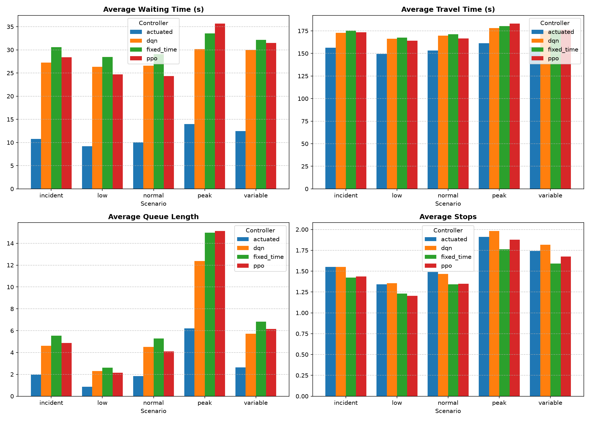
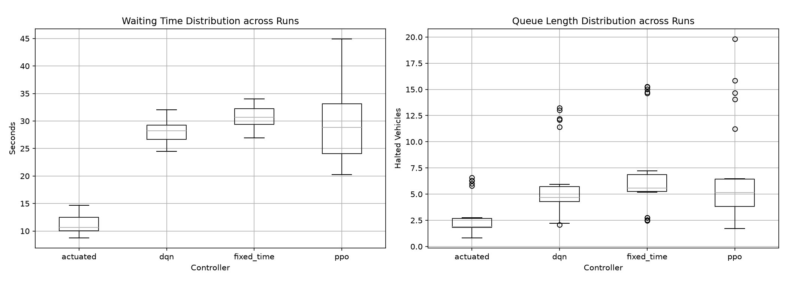

# AI-Based Traffic Optimization in a Digital Twin of Girona

## Abstract

This project evaluates traffic-light control strategies in a SUMO-based digital twin of Gran Via de Jaume I and the Eixample district of Girona, Spain. A 14-intersection road network was extracted from OpenStreetMap, simulated under five synthetic demand conditions, and used for traffic prediction and traffic-light control experiments. The control study compares fixed-time signals, SUMO actuated signals, and centralized reinforcement-learning (RL) controllers trained with PPO and DQN. The RL agents were trained for 100,000 environment decisions on the normal-demand scenario using five route-demand seeds and evaluated on five held-out seeds across low, normal, peak, variable-demand, and incident scenarios. Across 100 evaluation runs, DQN reduced mean waiting time by 8.79% against fixed-time control and PPO by 5.98%, while the actuated baseline reduced it by 63.30%. The results show that both RL agents learned policies that improve on fixed-time timing, but neither matched the strong actuated baseline under the available training budget. The project therefore supports a nuanced conclusion: RL is viable in this digital twin, but further training, reward design, and generalization experiments are necessary before claiming an advantage over adaptive rule-based control.

## 1. Introduction

Traffic congestion increases journey time, vehicle stops, fuel use, and emissions in urban networks. Traffic-light control is a natural optimization target because it directly allocates scarce intersection capacity. Traditional fixed-time plans are predictable but cannot react to demand variation. Actuated control adapts signal timing from local detectors, while reinforcement learning can in principle learn a network-level policy from observed traffic state.

This project asks:

1. **Can reinforcement learning reduce traffic congestion relative to fixed-time and actuated traffic-light control in a simulated urban network?**
2. **Does a controller trained under one traffic-demand distribution generalize to unseen traffic conditions?**

The contribution is not a city-scale operational claim. It is a reproducible AI research prototype that combines simulation, supervised traffic prediction, reinforcement learning, controlled baselines, multi-seed evaluation, and explicit limitations.

## 2. Digital Twin and Traffic Scenarios

### 2.1 Network

The digital twin represents a compact area around Gran Via de Jaume I and the Eixample district of Girona. The source road data is an OpenStreetMap extract with bounding box `2.8175,41.9790,2.8255,41.9855` (WGS84). It was converted with SUMO `netconvert`, restricted to the largest connected passenger-vehicle component, and includes:

- 261 directed road edges
- 150 junctions
- 14 traffic-light controllers

The import preserves OSM geometry and signal metadata, but it is a structural model rather than a calibrated operational network. The SUMO configuration and reproduction instructions are documented in [`simulation/README.md`](../simulation/README.md).

### 2.2 Demand scenarios

Each scenario has a 3,600-second nominal demand horizon and uses deterministic route-demand generation. Five scenarios are evaluated:

| Scenario | Demand definition | Purpose |
|---|---|---|
| Low | 1 vehicle every 10 s | Light-demand reference |
| Normal | 1 vehicle every 5 s | RL training distribution |
| Peak | 1 vehicle every 2 s | High-congestion generalization |
| Variable | Low → peak → low demand | Time-varying generalization |
| Incident | Normal demand with a 600 s passenger-edge closure | Disturbance and rerouting generalization |

Evaluation uses held-out demand seeds `47–51`; training uses seeds `42–46`. All reported controller comparisons contain five runs per scenario and controller, totaling 100 runs.

## 3. Traffic Prediction

A separate prediction pipeline collects one-minute observations at every traffic light across 25 simulation runs (five scenarios × five seeds). It predicts future per-intersection queue length using five recent observations of queue length, vehicle count, mean speed, throughput, and traffic-light phase.

The experiment compares persistence, historical mean, Random Forest, XGBoost, and a one-layer LSTM at 5, 10, and 15 minute horizons. The temporal split reserves the latest 20% of observations from each scenario/seed/intersection series for testing.

| Horizon | Best model by MAE | MAE | Best model by R² | R² |
|---:|---|---:|---|---:|
| 5 min | LSTM | 0.2790 | XGBoost | 0.5872 |
| 10 min | Random Forest | 0.3138 | Random Forest | 0.4965 |
| 15 min | LSTM | 0.2791 | LSTM | 0.5782 |

All learned models outperform persistence and historical-mean baselines. Full results are available in [`experiments/prediction/README.md`](../experiments/prediction/README.md).

## 4. Reinforcement Learning Methodology

### 4.1 Controllers

Four controllers are evaluated:

- **Fixed-time**: SUMO-imported static signal programs.
- **Actuated**: SUMO actuated programs derived from the same phase structures, with green minimum/maximum durations of 10/60 seconds.
- **PPO**: centralized policy with a MultiDiscrete action for all 14 traffic lights.
- **DQN**: centralized policy using a flattened discrete action encoding.

### 4.2 RL environment

The Gymnasium environment controls all 14 traffic lights every 10 seconds. Its 70-dimensional observation contains five values per intersection:

1. Halting-vehicle queue length
2. Vehicle count
3. Mean speed
4. Current phase index
5. Elapsed phase duration

PPO chooses one green phase per traffic light through:

```text
MultiDiscrete([1, 1, 1, 3, 2, 2, 2, 2, 2, 2, 1, 2, 2, 3])
```

DQN uses the equivalent flattened `Discrete(2304)` space. The reward is the negative number of halted vehicles over the controlled network at every decision point. A 10-second minimum green time and automatic yellow/all-red transitions prevent instantaneous unsafe switching.

### 4.3 Training

PPO and DQN were trained in Kaggle with CUDA enabled for 100,000 environment decisions each. Training demand uses the normal scenario and route-demand seeds `42–46`. The exact configuration is versioned in [`configs/rl/default.json`](../configs/rl/default.json), while the Kaggle notebook is [`notebooks/kaggle_rl_training.ipynb`](../notebooks/kaggle_rl_training.ipynb).

## 5. Experimental Results

### 5.1 Main comparison

The following table reports mean ± standard deviation across five held-out route-demand seeds per scenario. Lower waiting time, travel time, queue length, and stops are better; throughput is constant because all trips completed with zero teleports in every evaluated run.

| Scenario | Controller | Waiting time (s) | Travel time (s) | Queue length | Stops |
|---|---|---:|---:|---:|---:|
| Low | Fixed-time | 28.43 ± 1.50 | 167.60 ± 3.02 | 2.60 ± 0.14 | 1.23 ± 0.05 |
| Low | Actuated | **9.22 ± 0.49** | **149.51 ± 1.61** | **0.86 ± 0.04** | 1.34 ± 0.06 |
| Low | PPO | 24.73 ± 4.07 | 164.06 ± 4.16 | 2.15 ± 0.38 | **1.20 ± 0.04** |
| Low | DQN | 26.36 ± 1.51 | 166.28 ± 2.84 | 2.31 ± 0.14 | 1.36 ± 0.07 |
| Normal | Fixed-time | 29.08 ± 0.56 | 171.13 ± 0.65 | 5.29 ± 0.08 | **1.34 ± 0.05** |
| Normal | Actuated | **10.03 ± 0.29** | **153.24 ± 0.98** | **1.83 ± 0.06** | 1.49 ± 0.02 |
| Normal | PPO | 24.34 ± 3.28 | 166.67 ± 3.45 | 4.11 ± 0.58 | 1.35 ± 0.07 |
| Normal | DQN | 26.60 ± 1.12 | 169.57 ± 0.95 | 4.52 ± 0.17 | 1.47 ± 0.03 |
| Peak | Fixed-time | 33.56 ± 0.42 | 180.20 ± 0.54 | 14.97 ± 0.28 | **1.76 ± 0.02** |
| Peak | Actuated | **13.97 ± 0.55** | **161.25 ± 1.03** | **6.20 ± 0.30** | 1.91 ± 0.04 |
| Peak | PPO | 35.67 ± 6.44 | 183.09 ± 7.00 | 15.13 ± 3.13 | 1.88 ± 0.06 |
| Peak | DQN | 30.16 ± 1.66 | 177.95 ± 2.15 | 12.39 ± 0.75 | 1.98 ± 0.06 |
| Variable | Fixed-time | 32.17 ± 1.10 | 176.22 ± 2.00 | 6.82 ± 0.25 | **1.59 ± 0.04** |
| Variable | Actuated | **12.48 ± 0.41** | **157.36 ± 1.43** | **2.63 ± 0.09** | 1.74 ± 0.02 |
| Variable | PPO | 31.50 ± 2.60 | 176.38 ± 1.99 | 6.16 ± 0.47 | 1.68 ± 0.07 |
| Variable | DQN | 29.95 ± 0.83 | 175.39 ± 1.62 | 5.72 ± 0.15 | 1.82 ± 0.07 |
| Incident | Fixed-time | 30.60 ± 0.71 | 175.37 ± 0.98 | 5.55 ± 0.11 | **1.42 ± 0.06** |
| Incident | Actuated | **10.75 ± 0.62** | **156.36 ± 1.01** | **1.96 ± 0.11** | 1.55 ± 0.08 |
| Incident | PPO | 28.39 ± 4.01 | 173.37 ± 3.78 | 4.86 ± 0.72 | 1.44 ± 0.08 |
| Incident | DQN | 27.25 ± 1.72 | 172.67 ± 1.56 | 4.62 ± 0.25 | 1.55 ± 0.08 |





### 5.2 Aggregate improvement against fixed-time

Across all 25 held-out test runs per controller:

| Controller | Waiting-time reduction | Travel-time reduction |
|---|---:|---:|
| Actuated | **63.30%** | **10.66%** |
| PPO | 5.98% | 0.80% |
| DQN | 8.79% | 1.00% |

DQN outperforms fixed-time control in every evaluated scenario, reducing waiting time between 6.90% (variable demand) and 10.97% (incident). PPO improves over fixed-time in four scenarios but degrades under peak demand by 6.27%, with high between-seed variation (6.44 seconds). This identifies high demand as a key generalization failure mode for the current PPO policy.

### 5.3 Paired seed analysis

The same five held-out seeds are used for every controller, so waiting-time differences can be paired by scenario and seed. A one-sided Wilcoxon signed-rank test compares each controller with fixed-time control; its small sample size (`n = 5`) makes the result descriptive rather than conclusive.

- Actuated control improves waiting time in every paired run in all scenarios (`p = 0.0312` per scenario).
- DQN improves waiting time in every paired run for normal, peak, variable, and incident demand (`p = 0.0312`); low-demand improvement is positive but not below the 0.05 threshold (`p = 0.0625`).
- PPO does not reach the 0.05 threshold in any individual scenario and significantly degrades relative to fixed-time under peak demand in practical terms.

The exact paired statistics are in [`experiments/evaluation/paired_wilcoxon_waiting_time.csv`](../experiments/evaluation/paired_wilcoxon_waiting_time.csv).

### 5.4 Generalization analysis

Both RL agents are trained only on normal-demand traffic and are tested on unseen low, peak, variable, and incident conditions:

- **DQN** generalizes more consistently than PPO: it improves waiting time over fixed-time in all four unseen distributions.
- **PPO** transfers well to low demand (13.02% waiting-time reduction) and the incident scenario (7.23%), but not to peak demand.
- **Actuated control** is strongest in every scenario because its detector-driven policy adapts directly to the local demand realization.

The results therefore distinguish two claims. RL improves on a non-adaptive fixed-time baseline, but this experiment does **not** demonstrate that the available RL policies outperform a well-configured actuated baseline.

## 6. Ablation and Sensitivity Analysis

### 6.1 Controller ablation

The controller comparison itself is the primary ablation:

1. Fixed-time isolates a static baseline.
2. Actuated control adds local demand-responsive timing without learned parameters.
3. DQN adds centralized learned control through a flattened 2,304-action space.
4. PPO adds centralized learned control with a factorized MultiDiscrete action space.

This ablation shows that adaptive behavior alone accounts for a large performance gain. The RL design and training budget determine whether learned centralized control can recover that gain.

### 6.2 Distribution-shift sensitivity

The training distribution is normal demand. Held-out low, peak, variable, and incident scenarios act as distribution shifts. The largest sensitivity is PPO on peak demand, where both waiting time and travel time increase relative to fixed-time. DQN remains positive under each shift but produces smaller gains than actuated control.

### 6.3 Training-budget sensitivity

Only one training budget (100,000 decisions) is evaluated in this report. The saved Kaggle checkpoints allow a future learning-curve ablation at 25k, 50k, 75k, and 100k decisions. This experiment is intentionally listed as future work rather than inferred from a single final checkpoint.

## 7. Discussion

### Research question 1

**Can RL reduce traffic congestion compared with traditional control?**

Compared with fixed-time signals, yes in this digital twin: PPO and DQN reduce average waiting time by 5.98% and 8.79% respectively across the evaluation suite. Compared with the stronger actuated controller, no: the actuated baseline yields a 63.30% waiting-time reduction and is superior in every tested scenario.

The rigorous conclusion is therefore not “RL is best.” It is that centralized RL can learn a useful policy from SUMO traffic state, but the present implementation does not yet justify replacing a detector-driven actuated controller.

### Research question 2

**Does the normal-demand policy generalize to unseen traffic conditions?**

Partially. DQN generalizes to all four unseen distributions with modest positive reductions relative to fixed-time. PPO generalizes to low demand and incident conditions but fails under peak demand. This mismatch is consistent with the difficulty of a high-dimensional centralized action space, a reward that only measures instantaneous queues, and a training distribution that excludes sustained peak demand.

## 8. Limitations

- Demand is synthetic and not calibrated against real Girona traffic counts, turning counts, signal plans, or detector data.
- The OSM import may not reproduce all real lane restrictions, offsets, public-transport interactions, or signal priorities.
- The actuated controller is a strong SUMO baseline but not a validated model of Girona's deployed controller.
- Evaluation uses five held-out demand seeds; this is adequate for an MVP but limited for inferential statistics.
- PPO and DQN use one reward formulation, one 100k-decision budget, and one network representation.
- The centralized 2,304-action DQN space remains difficult to explore efficiently.
- Emissions are not included in the present controller comparison.

## 9. Future Work

1. Calibrate demand and signal timing using observed counts or official open data.
2. Train across mixed scenarios and curriculum demand levels rather than normal demand alone.
3. Add training-budget, reward-function, minimum-green, and decision-interval ablations.
4. Compare against max-pressure or other traffic-control baselines in addition to actuated control.
5. Add emissions, fairness across approaches, and pedestrian/public-transport objectives.
6. Investigate parameter-sharing multi-agent RL to avoid the centralized combinatorial action space.
7. Test transfer to a second Girona neighborhood or unseen network topology.

## 10. Reproducibility

All source data, SUMO conversion commands, scenario JSON files, seeds, trained controller metadata, evaluation metrics, and analysis scripts are included in the repository. Heavy RL training and full evaluation should run in Kaggle using [`notebooks/kaggle_rl_training.ipynb`](../notebooks/kaggle_rl_training.ipynb). Local machines should be reserved for smoke tests, static analysis, and post-processing; they are not required to reproduce compute-intensive training.
